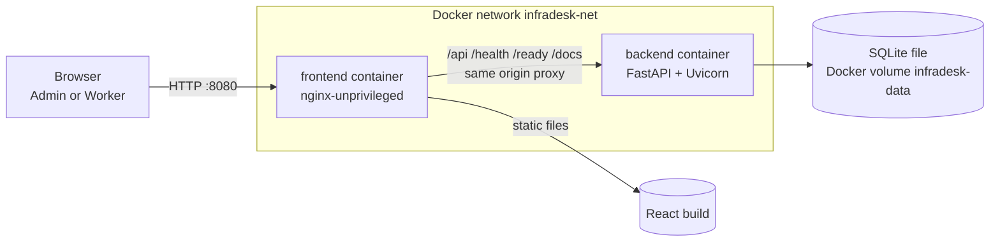
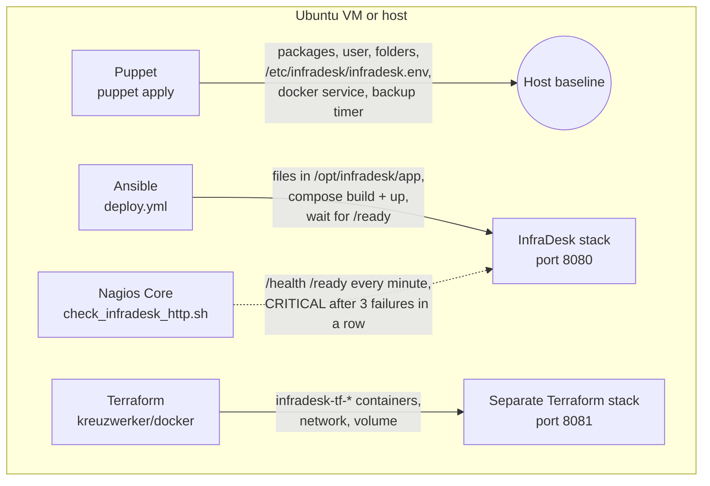

# Architecture

## Runtime view (Docker Compose mode)



Design decisions and the reason for each:

| Decision | Reason |
|---|---|
| nginx serves the React build **and** proxies the API (same origin) | The session cookie is HttpOnly and `SameSite=Lax`; same origin means no CORS and no token in JavaScript |
| `proxy_set_header Host $http_host` | The backend compares a browser `Origin` header with `Host` (CSRF check); the port must be kept |
| SQLite on a named volume | One computer, zero extra services, survives container re-creation |
| WAL journal mode, foreign keys on | Concurrent readers during writes; referential integrity is enforced by SQLite |
| Backend not published to the host | Only nginx talks to it (smaller attack surface) |
| Containers run as non-root, `no-new-privileges`, all capabilities dropped, memory limits | Safe defaults for a laptop |
| Alembic migration runs at container start | The schema is always at the version the code expects |

## Layers of the backend

```
api/v1/*.py        thin route handlers: parse request, call a service, return a schema
api/deps.py        authentication (cookie -> user), admin check, pagination, CSRF origin check
services/*.py      all business rules: visibility, workflow transitions, assignment, notifications, reports
models/*.py        SQLAlchemy tables
schemas/*.py       Pydantic request/response models and input validation
core/*.py          settings, password hashing and tokens, error handling
db/*.py            engine, session, migration runner
```

Rules live in `services/`, so they are tested without HTTP details and cannot be bypassed by a
route that forgets a check. Every route that returns ticket data goes through
`ticket_service.get_visible_ticket` or `list_tickets`, which apply the role rules.

## Frontend structure

`api/client.ts` is the only place that calls `fetch`; it parses the standard error shape into an
`ApiError`, and a 401 anywhere clears the session and returns to the login page.
`auth/` holds the sign-in state and route protection. `pages/` has one folder of shared pages and
the admin/worker pages; `components/` holds reusable pieces (tables, badges, dialogs, pagination).
There are no icon libraries, no web fonts and no CDN references.

## DevOps view (demonstration mode)



Terraform and Compose/Ansible are alternative deployment modes with different names and ports,
so they never own the same container. Nagios reports a failure; a human then runs
`ansible-playbook playbooks/rollback.yml --tags recover` (restart) or the rollback play. There is no
automatic self-healing.
