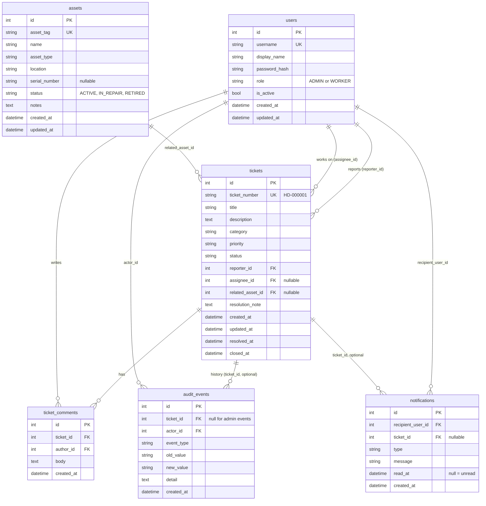

# Database design

SQLite by default (single computer, no extra service). The schema is created by Alembic migration
`0001_initial_schema`; the container runs `alembic upgrade head` at start. SQLite is right for a
local prototype; many simultaneous users in production would call for PostgreSQL (the code uses
SQLAlchemy and no SQLite-only SQL, but this has not been tested on PostgreSQL).

## Decisions

- **History table:** the specification allowed `ticket_history` or a generic audit table. InfraDesk uses one
  generic `audit_events` table. Rows with a `ticket_id` are the per-ticket history; rows without one record user and
  asset administration (the Activity page).
- **No hard deletes of referenced records.** All foreign keys use `ON DELETE RESTRICT`; users are deactivated and assets
  are retired, tickets are cancelled or closed. History can never disappear by cascade.
- **UTC everywhere.** A custom column type stores naive UTC and always returns timezone-aware UTC; the browser shows local time.
- **Indexes** on the filtered columns: ticket status, category, reporter, assignee, created date, status+priority; username,
  ticket number, asset tag; notification recipient + read state; audit ticket and date.
- **Enums are stored as short strings** (not native database enums), so adding a value needs no table rebuild.
- **Passwords** are stored only as Argon2 hashes and never returned by any endpoint.
