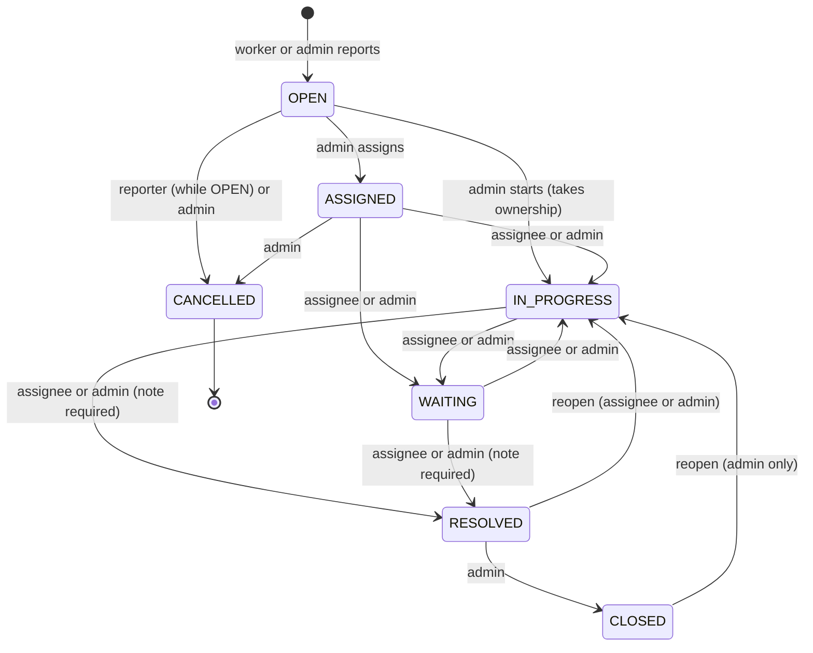

# Ticket workflow

## Statuses

`OPEN`, `ASSIGNED`, `IN_PROGRESS`, `WAITING`, `RESOLVED`, `CLOSED`, `CANCELLED`.
The allowed moves are defined once, in `TRANSITIONS` in `backend/app/services/ticket_service.py`, and
a test (`test_transition_table_matches_specification`) compares the table with the specification.

## Who may do what

| Action | Admin | Assigned worker | Reporter (not assignee) | Other worker |
|---|---|---|---|---|
| See the ticket | yes | yes | yes | no (404) |
| Assign / reassign | yes | no | no | no |
| Edit title, description, category, priority | yes | no | no | no |
| Start, wait, resolve, reopen own resolved ticket | yes | yes | no | no |
| Close, reopen a closed ticket | yes | no | no | no |
| Cancel | yes | no | only while `OPEN` | no |
| Comment | yes | yes | yes | no |

`ASSIGNED` can only be reached through the assign action, so a ticket never shows "assigned" without an assignee.

## Side effects of each action

| Action | History event | In-app notification to |
|---|---|---|
| Create | `TICKET_CREATED` | all active admins (except the actor) |
| Assign | `TICKET_ASSIGNED` (+ `STATUS_CHANGED` if it was OPEN) | the assignee; the reporter |
| Status change | `STATUS_CHANGED` (resolution text for RESOLVED) | reporter and assignee; admins too on RESOLVED |
| Comment | `COMMENT_ADDED` | reporter and assignee |
| Edit fields | `TICKET_UPDATED` per changed field | none |

The person who performs an action is never notified about it. Notifications are in-app only
(bell and notifications page); there is no e-mail, SMS or push.

## Priorities and categories

Priorities: `LOW`, `MEDIUM`, `HIGH`, `URGENT`. Categories: `HARDWARE`, `SOFTWARE`, `NETWORK`,
`ACCOUNT_ACCESS`, `PRINTER`, `OTHER`. The ticket number `HD-000001` is derived from the database id and never changes.
